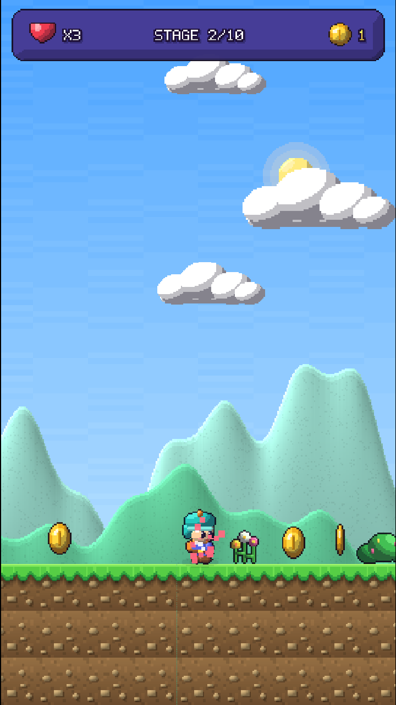
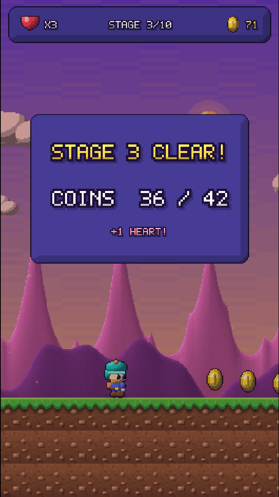
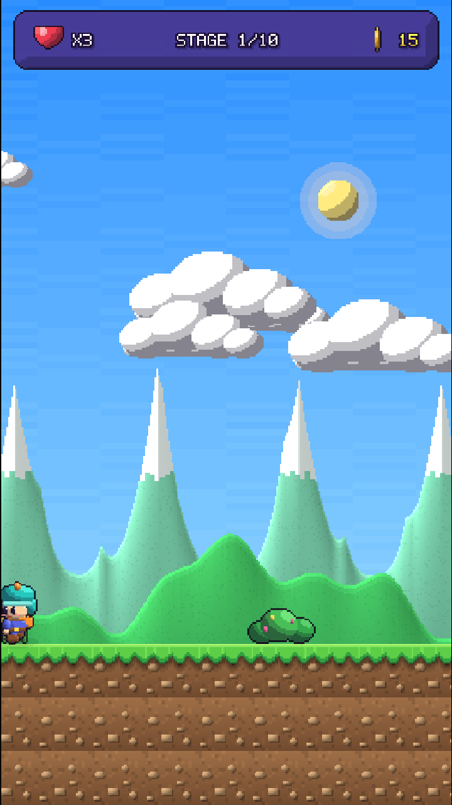

# Changelog

All notable changes to Pixel Hopper. Newest first. Update this file with every fix or feature.

## [Unreleased]
- (nothing yet)

## [1.1.0] - 2026-10-06
Update 3: **Fair play.** Three bug fixes reported by the owner plus a new lives rule and bonus hearts.

### What changed (player-facing)
- **Removed the "CLICK THE GAME TO PLAY" box added in 1.0.2.** It duplicated the prompt on the title screen. The title prompt itself now reads "CLICK OR PRESS SPACE TO START", so a click both focuses the game and starts it.
- **The camera no longer scrolls back.** Once the screen has moved forward it stays there, and the left edge of the screen blocks the player, like classic platformers. The player can still walk back a few tiles inside the screen, but not into ground that has been left behind. After losing a life the camera returns to the start with the player.
- **Jumping over the flag pole now finishes the stage.** The goal is a full-height line instead of a 3-tile trigger, so no jump can clear it.
- **New lives rule.** Lives belong to the whole run: you start with 3, they do not refill between stages, and the maximum is 5. Clearing a stage gives back 1 heart ("+1 HEART!" on the clear panel). When the lives run out it is game over and the next run starts again at stage 1 with 3 lives and no coins (before, game over retried the same stage and every stage started with 3 lives).
- **Bonus hearts inside stages.** From stage 2 there is a rest area with a heart in the middle of the stage; from stage 6 there is a second one later on. Touching a heart gives 1 life (up to 5). At 5 lives the heart is left where it is. Stages 2 to 10 are about 9 to 18 tiles longer because of the rest areas; their enemies and spikes did not change.

### Screenshots
| | |
|---|---|
|  |  |
| New title prompt: "CLICK OR PRESS SPACE TO START" | A bonus heart in a stage 2 rest area (hearts show x2) |
|  |  |
| Heart collected: hearts go from x2 to x3 | Stage clear panel: "+1 HEART!" |
|  |  |
| Game over: "YOU START OVER AT STAGE 1" | The hero stopped by the left edge of the screen |

### Code changes
- `Assets/Scripts/Game.cs`: lives are now per run (`StartingLives = 3`, `MaxLives = 5`); `lives` is no longer reset in `StartLevel`; game over restarts at stage 1; `LevelComplete` awards a heart; new `AddLife()` and `CameraLeftEdge`; `PlayerDied` re-centres the camera after a respawn; new heart tile `h` in `BuildLevel`; UI text (title prompt, clear panel, game over panel). The `coinsAtStageStart` field was removed because retrying a stage no longer exists.
- `Assets/Scripts/CameraFollow.cs`: one-way camera (`maxX` ratchet in `LateUpdate`), `LeftEdge` property and `Recenter()`.
- `Assets/Scripts/PlayerController.cs`: in `FixedUpdate`, the player is stopped at the left edge of the screen.
- `Assets/Scripts/Pickups.cs`: `LevelExit` trigger is now 1 x 8 tiles instead of 1 x 3; new `HeartPickup` class.
- `Assets/Scripts/Levels.cs`: new tile `h`, `AddHeart`, new `HeartRest` chunk that the generator inserts at fixed points (it uses no random numbers, so other chunks are unchanged).
- `Assets/Scripts/Sfx.cs`: new `OneUp` sound for a bonus life.
- `Assets/WebGLTemplates/PixelHopper/index.html`: back to the 1.0.1 version (the focus hint was removed).
- `Assets/Editor/BatchChecks.cs` (new, editor only): automated rule checks (flag, camera, lives, carry-over, hearts). `Assets/Editor/BatchBot.cs`: the stage report also counts hearts.
- `ProjectSettings/ProjectSettings.asset`: version 1.1.0.

### Verified
- `BatchChecks` runs 11 checks. On the 1.0.2 code, 5 failed (flag, camera scrolling back, restart at stage 1, lives carry-over, heart missing); on the 1.1.0 code all 11 pass.
- Test bot cleared all 10 stages (at most 1 death in a stage).

## [1.0.2] - 2026-10-06
Update 2: **Desktop first run.** Fewer players stuck on a game that "does not respond" or does not fit their screen.

### What changed (player-facing)
- A yellow hint, "CLICK THE GAME TO PLAY", now appears over the game whenever the game does not have keyboard focus, and disappears as soon as the player clicks it. On itch.io the first key press used to go to the page instead of the game, so the game looked frozen; now the player is told what to do. The click that removes the hint also starts the game from the title screen.
- itch.io page setting (not code): a smaller embed viewport of 405 x 720 was suggested, but the owner tried it and went back to **540 x 960**: the smaller frame cropped the cover image and showed more purple page background. The viewport stays 540 x 960 and players on small laptops use the fullscreen button.

### Code changes
- `Assets/WebGLTemplates/PixelHopper/index.html` (the only game file changed): a new `#focus-hint` element with its CSS (centred, pulsing, `pointer-events: none` so clicks pass through to the game), and a few lines of JavaScript, `updateFocusHint()`, which shows the hint while the game is running and `document.hasFocus()` is false. It re-checks on `focus`, `blur`, `visibilitychange`, `pointerdown` and a 500 ms timer (iframes do not always fire focus events).
- No C# code changed. `ProjectSettings/ProjectSettings.asset`: version number 1.0.1 to 1.0.2.

### Verified
- Tested inside a cross-origin iframe on a stand-in "itch page": the game loads, the hint appears when the page outside the game is clicked, and disappears when the game is clicked.
- The original problem (first Space press ignored) could **not** be reproduced in the test browser, where Space worked at once, so the real itch.io behaviour should be checked after upload (steps in `docs/TESTING.md`).

## [1.0.1] - 2026-10-06
Update 1: **Stage 1 gets its first enemy.**

### What changed (player-facing)
- Stage 1 now has one slow enemy, placed as the third section of the stage, after the player has practised jumping over a gap and a wall. Before this, enemies first appeared in stage 2 even though the help dialog already says "stomp enemies".
- Because that section replaced another one, stage 1 has 24 coins instead of 32 and is one tile shorter (67 tiles instead of 68). Stages 2 to 10 are exactly the same as in 1.0.0 (checked with the new stage report).

### Code changes
- `Assets/Scripts/Levels.cs`: in `Levels.Build`, one new line forces the third chunk of stage 1 to be the existing `Kind.Enemies` chunk, with an explanatory comment. No new enemy code was needed because the enemy type and the chunk already existed.
- `Assets/Editor/BatchBot.cs` (new, editor only): runs the test bot from the command line without opening the editor (`BatchBot.Run`) and prints a per-stage report of width, coins, enemies and spikes (`BatchBot.Report`). Used to prove stage 1 is still beatable and that no other stage changed.
- `Assets/Editor/ReleaseBuild.cs` (new, editor only): builds the WebGL release with the correct settings in one repeatable command, so every update is built the same way.
- `ProjectSettings/ProjectSettings.asset`: version number 1.0.0 to 1.0.1.

### Verified
- Test bot clears stage 1 with 0 deaths.
- Stage report: only stage 1 differs from 1.0.0 (enemies 0 to 1, coins 32 to 24, width 68 to 67).
- WebGL build (custom template, 11.6 MB zip) loads in a browser without console errors and plays through stage 1 into stage 2.
### Documentation
- Added full reference documentation in `docs/` (overview, architecture, scripts, level design, art, audio, UI, testing, WebGL and itch.io, branding, decisions, glossary) with an index at `docs/README.md`
- Added doc comments and "why" comments to every C# script, the editor branding tool and the WebGL page template (no code changes)
- Added `tools/verify_comment_only.py` to prove comment-only edits leave the code unchanged

## [1.0.0] - 2026-10-05
First public release on itch.io (WebGL).

### Added
- 10 stages generated from hand-tuned chunks (gaps, walls, stairs, spikes, enemies, platforms, spike runs, gauntlets), with difficulty rising per stage
- 10 world themes: Sunny Meadow, Cloud Hills, Sunset Run, Autumn Trail, Deep Cave, Frozen Peaks, Dusty Desert, Midnight, Lava Fields, Final Storm
- Portrait 9:16 view with look-ahead camera and pillarbox bars on wide screens
- Shaded pixel-art hero, enemy, coins (spinning), tiles, spikes, flag and scenery props
- Parallax backdrops, sun/moon, stars, clouds, ambient particles (snow, leaves, embers, fireflies, rain)
- Procedural chiptune music and sound effects for jump, coin, stomp, hurt, steps, landing, stage clear, game over
- Pixel font, 3D logo, HUD, title screen, stage banners, stage-clear and game-over panels
- "How to play" dialog with OK and Skip buttons
- Keyboard, gamepad and touch controls
- Custom WebGL page template with loading bar; gzip build with decompression fallback

### Known at release
- See [docs/KNOWN_ISSUES.md](docs/KNOWN_ISSUES.md)
