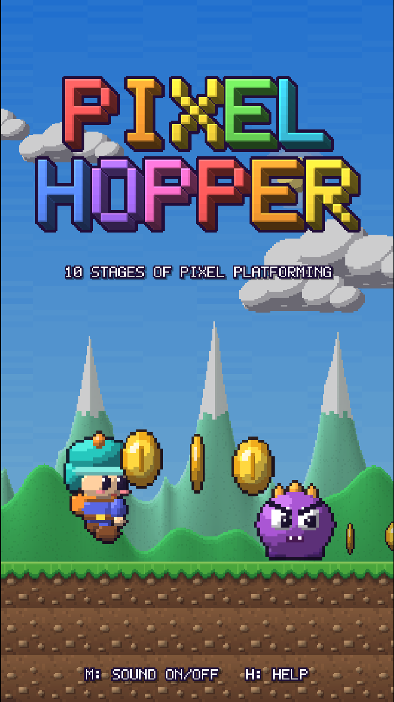
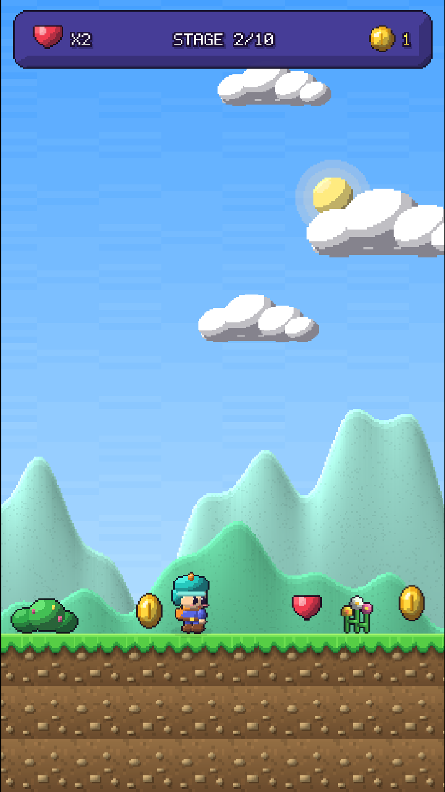
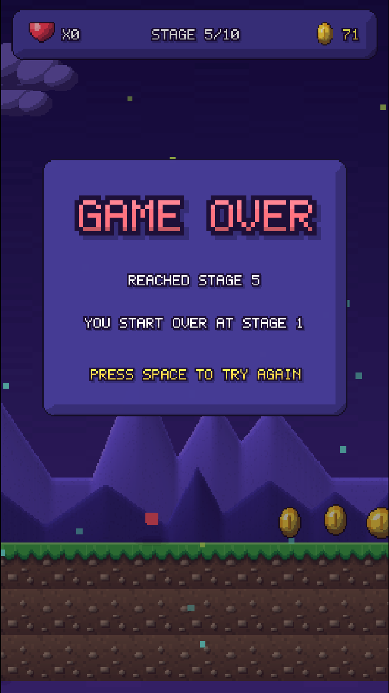

# Pixel Hopper

   

A tiny portrait pixel platformer in 10 stages. Stomp enemies, dodge spikes and pits, grab coins, reach the flag.

**Play it free in your browser:** https://the-protagonist07.itch.io/pixel-hopper

  
  
  
  

- Unity 6 (6000.6), URP, new Input System, 2D physics
- Portrait 9:16 with a narrow view and camera look-ahead
- 10 generated stages with 10 themes (sky, parallax mountains, scenery, ambient particles)
- All art, music and sound effects are generated in code (no imported asset packs)
- Plays in the browser (WebGL) on desktop and phone

## Controls
| Device | Move | Jump |
|---|---|---|
| Keyboard | A / D or arrows | Space, W or Up (hold = higher) |
| Gamepad | Left stick / D-pad | A / bottom button |
| Touch | Left side of screen | Right side of screen |

`M` mutes, `H` opens the help dialog.

## Project layout
| Path | What it is |
|---|---|
| `Assets/Scripts/Game.cs` | Game state, level building, HUD, title and help dialog |
| `Assets/Scripts/Levels.cs` | Stage generator (chunk based) and the 10 world themes |
| `Assets/Scripts/PlayerController.cs`, `Enemy.cs`, `Pickups.cs` | Gameplay objects |
| `Assets/Scripts/PixelPainter.cs`, `PixelArt.cs` | Procedural, shaded pixel-art sprites |
| `Assets/Scripts/PixelFont.cs` | Pixel font, 3D logo, UI kit |
| `Assets/Scripts/Backdrop.cs` | Sky, parallax layers, ambient particles |
| `Assets/Scripts/Sfx.cs` | Procedural chiptune music and sound effects |
| `Assets/WebGLTemplates/PixelHopper/` | Custom page template for the WebGL build |
| `Assets/Editor/CoverArt.cs` | Editor tools that render the logo, cover, page art and embed cover |
| `docs/` | Engineering documentation (start at [docs/README.md](docs/README.md)) |
| `marketing/` | Logo, cover, page art, promo clips, update screenshots ([marketing/README.md](marketing/README.md)) |
| `management/` | How the project is run, release log, status ([management/README.md](management/README.md)) |
| `sales/` | Traction and store plans, metrics log ([sales/README.md](sales/README.md)) |
| `builds/` | WebGL builds and itch.io zips per version (not committed; zips are attached to GitHub Releases) |
| `tools/` | Helper scripts (`verify_comment_only.py`, `crop_shots.py`, `make_clip.py`) |

Everything about the project lives in this one folder and one repository; see [docs/PROJECT_LAYOUT.md](docs/PROJECT_LAYOUT.md).

Every script starts with a summary comment and explains non-obvious code inline.

## Docs
Start with [docs/README.md](docs/README.md), the index with reading paths.

| Topic | File |
|---|---|
| The pitch, numbers and tech stack | [docs/PROJECT_OVERVIEW.md](docs/PROJECT_OVERVIEW.md) |
| How the pieces fit together (diagrams) | [docs/ARCHITECTURE.md](docs/ARCHITECTURE.md) |
| What each script does | [docs/SCRIPTS.md](docs/SCRIPTS.md) |
| Stage generator, difficulty, worlds | [docs/LEVEL_DESIGN.md](docs/LEVEL_DESIGN.md) |
| Procedural art and backdrops | [docs/ART_PIPELINE.md](docs/ART_PIPELINE.md) |
| Synthesised sound and music | [docs/AUDIO.md](docs/AUDIO.md) |
| Pixel font, UI kit, layout, input | [docs/UI_SYSTEM.md](docs/UI_SYSTEM.md) |
| Test bot, screenshots, checklist | [docs/TESTING.md](docs/TESTING.md) |
| Web build and itch.io publishing | [docs/WEBGL_BUILD_AND_ITCH.md](docs/WEBGL_BUILD_AND_ITCH.md) |
| Logo, cover and page art tool | [docs/BRANDING_AND_PAGE_ART.md](docs/BRANDING_AND_PAGE_ART.md) |
| Why things are built this way | [docs/DECISIONS.md](docs/DECISIONS.md) |
| Terms explained | [docs/GLOSSARY.md](docs/GLOSSARY.md) |
| Planned upgrades, store path | [docs/ROADMAP.md](docs/ROADMAP.md) |
| Open bugs | [docs/KNOWN_ISSUES.md](docs/KNOWN_ISSUES.md) |
| Build and release checklist | [docs/DEV_NOTES.md](docs/DEV_NOTES.md) |
| History of changes | [CHANGELOG.md](CHANGELOG.md) |

## Credits
Made with Unity. All art, music and sound effects are generated in code.

## License
[MIT](LICENSE) © 2026 Shivam Chaurasia. The game is free to play on itch.io, and the code is open source. All art, music and sound effects are generated in code, so there are no third-party assets to attribute.
