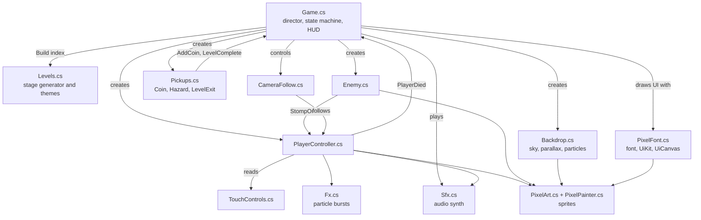
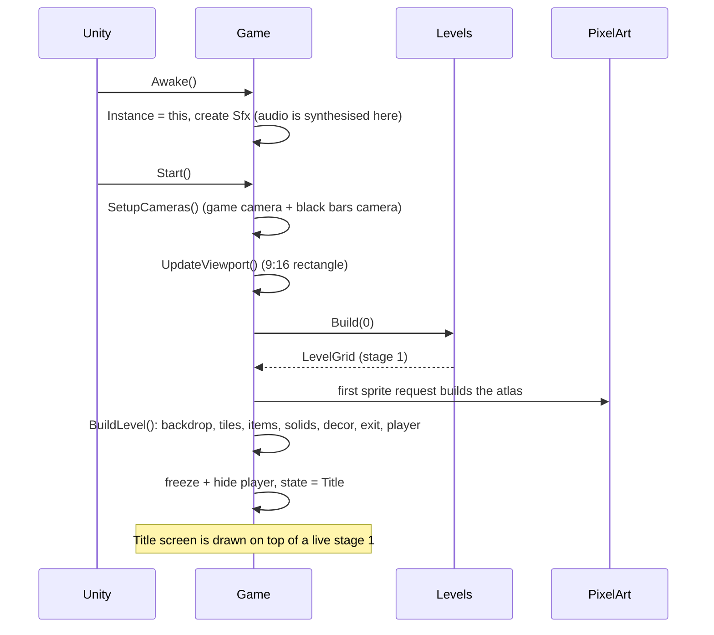
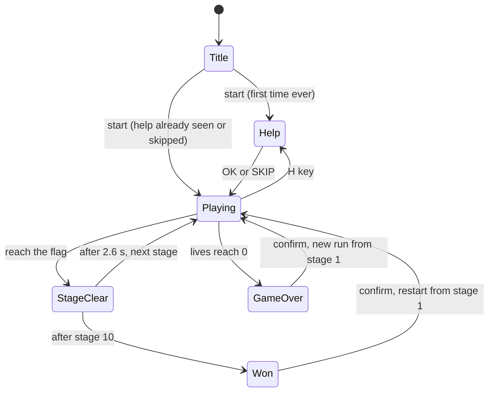
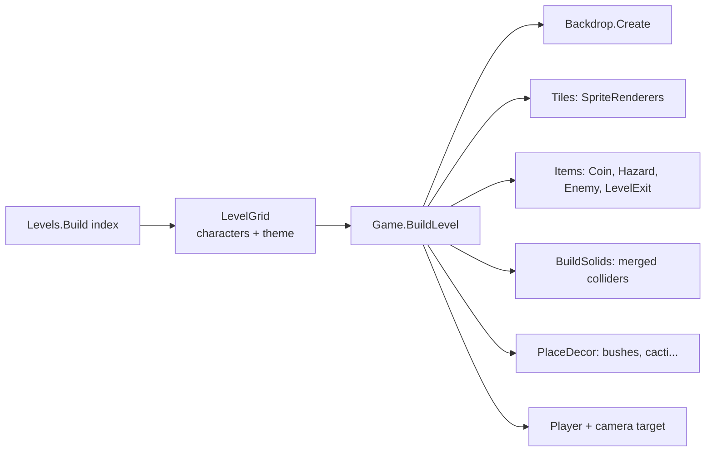

# Architecture

How the pieces fit together at runtime. For per-file detail see [SCRIPTS.md](SCRIPTS.md).

## The big idea

> The scene contains a camera and one `Game` object. At startup `Game` **builds everything else in code**.

There are no prefabs and no hand-placed objects. A stage is data (a grid of characters made by `Levels`); `Game`
reads the grid and creates GameObjects from it. Each object type (`Coin`, `Hazard`, `Enemy`, `PlayerController`...)
creates its own sprite and colliders in `Awake`. The benefits: no asset wiring to break, trivially deterministic
stages, and the whole game is reviewable as plain text.

## Module map



Arrows mostly point from "owner" to "owned". The few calls going back to `Game` are events: a coin was collected,
the player died, the stage was completed.

## Startup sequence



The title screen is stage 1 running behind a dimming layer, so the background parallax and particles are alive
while the logo bobs.

## State machine



Notes:

- `Help` pauses the game with `Time.timeScale = 0`. Anything animated in the UI therefore uses `Time.unscaledTime`.
- Dying with lives left stays in `Playing`: the player respawns at the stage start with 2 seconds of invulnerability.
- Lives belong to the whole run: 3 at the start, +1 for every cleared stage, bonus hearts inside stages, at most 5. Game over starts a new run at stage 1 with 3 lives and no coins.
- The camera only scrolls forward and the left edge of the screen is a wall for the player (`Game.CameraLeftEdge`); after a respawn the camera is re-centred (`CameraFollow.Recenter`).

## How a stage is built



Everything is parented under one `levelRoot` object named `Stage N`. Unloading a stage is one `Destroy(levelRoot)`.

### Runtime object tree (what you see in the Hierarchy while playing)

```
Main Camera            (CameraFollow added at runtime)
Game                   (Game, Sfx)
  BarsCamera           (black letterbox camera)
UI Canvas              (created by UiCanvas on first draw; pooled RawImages)
Stage N                (levelRoot)
  Backdrop             (sky, stars, sun/moon, far/near layers, clouds, flash)
    Ambient Snow ...   (particles, if the theme has any)
  Tiles                (one SpriteRenderer per ground/brick cell)
  Solids               (a few BoxCollider2D rectangles, no graphics)
  Items                (Coin, Spikes, Enemy, Exit objects)
  Decor                (scenery props)
  Player               (Rigidbody2D, BoxCollider2D, PlayerController)
    Visual / Shadow
```

## Collision and physics design

- Physics layers 8 (player) and 9 (enemy) are used only as bit numbers in masks; they are not named in the Tag Manager.
- `GroundMask` = everything except the player and enemy layers. Used for ground checks, shadow rays, AI rays.
- Triggers are ignored by queries (`Physics2D.queriesHitTriggers = false`) so rays never hit coins or hit boxes.
- Solid cells are merged into few rectangles ([BuildSolids](SCRIPTS.md#gamecs)) so the player never snags on tile seams.
- An enemy has a solid body and a larger trigger hit box. The player and enemy bodies ignore each other
  (`Physics2D.IgnoreCollision`); all contact logic goes through the hit box and `PlayerController.StompOrHurt`.
- Physics step is the Unity default (50 Hz); rigidbodies use interpolation for smooth rendering.

## Update order

| Order | Script | Reason |
|---|---|---|
| -100 | `Game` | Builds stages before other scripts run their first frame |
| 0 | `PlayerController`, `Enemy`, others | Gameplay |
| (LateUpdate) | `CameraFollow` | Moves after the player has moved |
| 100 (LateUpdate) | `Backdrop` | Reads the camera's final position |
| (LateUpdate) | `Game.LateUpdate` | Draws the UI with the final game state |

## Rendering model

- Orthographic camera, 15 tiles tall. A second black camera fills the window so a 9:16 rectangle can sit inside any
  window shape (pillarbox on wide windows, letterbox on tall ones).
- All sprites use point filtering; the camera and parallax layers snap to the 1/32-unit pixel grid so nothing shimmers.
- Sorting orders (back to front): sky -100, stars -95, sun/moon -90, far layer -80, near layer -70, clouds -60..-54,
  decor -1, tiles 0, coins 1, enemies 2, player 3, ambient particles 40, lightning flash 80, UI canvas 100.
- No post-processing, no HDR, no MSAA (all would blur or cost speed for pixel art).

## Where state lives

| State | Owner |
|---|---|
| Current stage, lives, coins, game state | `Game` |
| Stage layout | `LevelGrid` (rebuilt each time from a fixed seed) |
| Player motion and timers | `PlayerController` |
| "Help skipped" preference | `PlayerPrefs` (key `pixelhopper_help_skipped`; browser local storage on the web) |
| Mute | `Sfx` (not persisted) |

Nothing else is saved between sessions: there is no save file, score list or progress system yet.
